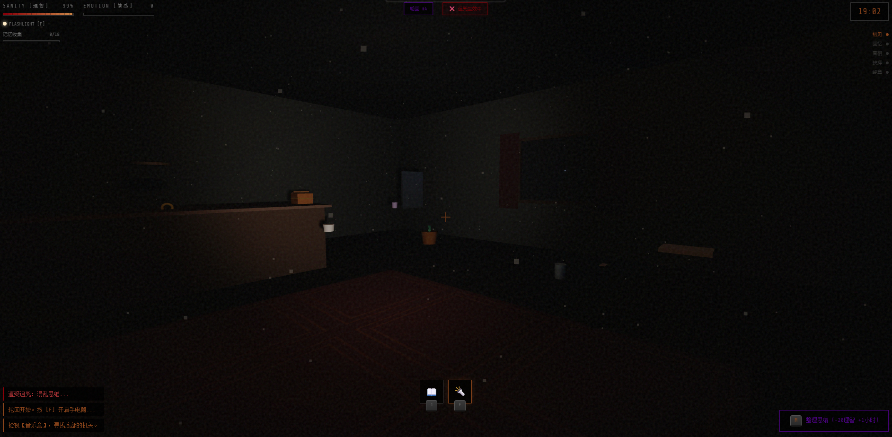

# 🕯️ 昨日回响 | Echoes of Yesterday

[](https://CNSleepybear.github.io/echoes-of-yesterday/)
[](https://threejs.org/)
[](LICENSE)

一款基于 **Three.js** 开发的**心理恐怖叙事解谜**游戏，融合**环境探索**、**情感叙事**与**多结局系统**，纯前端实现，开箱即玩。

> *"回到充满回忆的咖啡馆，在理智与情感的边缘，寻找被时间掩埋的真相。"*

---




## ✨ 功能特性

### 🎮 核心探索系统
- **沉浸式3D环境**：基于 Three.js 的程序化复古咖啡馆场景
- **第一人称视角**：真实的头部晃动、冲刺与潜行机制
- **动态光照系统**：手电筒照明、环境光变化、CRT 复古滤镜
- **物品检视机制**：360度旋转观察物品，发现隐藏机关与线索

### 🧠 心理恐怖体验
- **双资源管理系统**：理智值(Sanity)与情感值(Emotion)的动态平衡
- **理智崩溃机制**：低理智状态下触发幻觉、影子闪现、物品移位
- **威胁系统**：动态影子实体、低语声、手电筒闪烁故障
- **氛围音效**：程序化生成的环境音、心跳声、威胁音效

### 📖 深度叙事架构
- **18件记忆物品**：每件物品承载独特的回忆片段与情感价值
- **7种差异化谜题**：
  - 音乐盒机关（热点点击）
  - 日记密码锁（数字推理）
  - 信件排序（时间线重构）
  - 油画拼图（色块交换）
  - 镜像密码（空间翻转）
- **回忆日记系统**：收集记忆碎片解锁隐藏剧情
- **动态叙事阶段**：5个故事阶段推进剧情发展

### 🎭 多结局系统
8种不同结局路线，基于收集进度、理智值、情感值综合判定：
- **铭记** (Remembering)：直面过去，永远怀念
- **遗忘** (Forgetting)：选择放下，重新开始
- **救赎** (Redemption)：发现真相，原谅自己
- **沉沦** (Descent)：理智崩溃，永远徘徊
- **永恒** (Eternal)：留在回忆中，与爱共存
- **接纳** (Acceptance)：与悲伤和解，继续前行
- **和解** (Reconciliation)：拼凑完整记忆，达成理解
- **领悟** (Understanding)：解开所有谜题，读懂心意

---

## 🚀 在线体验
**🔗 [立即体验 昨日回响](https://CNSleepybear.github.io/echoes-of-yesterday/)**

### 🕹️ 操作指南

| 操作 | 功能 |
| :--- | :--- |
| `W/A/S/D` | 移动探索 |
| `Shift` | 冲刺 |
| `Ctrl` | 蹲下 |
| `鼠标` | 环顾四周 |
| `E` | 互动/检视物品 |
| `F` | 开关手电筒 |
| `J` | 打开回忆日记 |
| `M` | 整理思绪（柜台附近恢复理智）|
| `ESC` | 关闭面板/退出检视 |

### 🎯 检视模式操作
- **鼠标左键拖拽**：旋转物品
- **滚轮**：缩放观察
- **点击热点**：触发机关/解锁谜题
- `E` / `ESC`：收起物品

---

## 🛠️ 技术栈
- **Three.js r128**：WebGL 3D 渲染引擎
- **程序化纹理生成**：Canvas API 动态生成木质、墙纸、地毯材质
- **Web Audio API**：动态音效合成（无需外部音频文件）
- **LocalStorage**：本地存档系统
- **CSS3 特效**：CRT 扫描线、胶片颗粒、暗角效果

---

## 📦 本地运行

### 📋 环境要求
- 现代浏览器（Chrome 80+ / Firefox 78+ / Edge 80+ / Safari 13+）
- 支持 WebGL 与 Pointer Lock API
- 建议分辨率：1920×1080 或更高
- 佩戴耳机获得最佳音频体验

### ⚡ 快速开始

```bash
# 克隆仓库
git clone https://github.com/CNSleepybear/echoes-of-yesterday.git
cd echoes-of-yesterday

# 启动本地服务器（必需用于 Pointer Lock 等功能）
python -m http.server 8000
# 或
npx http-server -p 8000
# 或 VS Code Live Server

# 浏览器访问
open http://localhost:8000
```

---

## 📁 项目结构

```
echoes-of-yesterday/
├── index.html          # 游戏主文件（含完整 CSS 与 JavaScript）
├── README.md           # 项目说明
├── LICENSE             # MIT 许可证
├── .gitignore          # Git 忽略配置
└── screenshot.png      # 游戏截图（可选）
```

> **注意**：本项目为单文件应用，所有资源（3D模型、纹理、音效）均通过代码程序化生成，无需外部依赖。

---

## 🎨 游戏机制详解

### 理智系统 (Sanity)
- 随时间自然流逝
- 遭遇恐怖事件时大幅下降（影子闪现、低语等）
- 通过**冥想**（M键，需在柜台附近）恢复
- 低于30%触发幻觉视觉效果与威胁事件

### 情感系统 (Emotion)
- 收集记忆物品、解开谜题时增长
- 影响最终结局判定
- 高情感值解锁深层叙事内容

### 记忆收集
- **18件核心物品**：结婚照、音乐盒、旧日记、泰迪熊等
- **前置解锁机制**：部分物品需要先收集相关线索
- **秘密房间**：收集特定物品后解锁隐藏区域

### 谜题类型
| 谜题 | 机制 | 位置 |
| :--- | :--- | :--- |
| 音乐盒 | 点击底部机关 | 柜台旁 |
| 日记本 | 3位数字密码（317） | 沙发边 |
| 信件 | 按时间排序5封信 | 窗边 |
| 油画 | 4×4色块拼图 | 墙上 |
| 镜子 | 镜像数字解码 | 角落 |

---

## 🧩 自定义配置

可在 `GameEngine` 初始化前修改以下配置：

```javascript
// 游戏平衡调整
GameEngine.state.sanity = 100;        // 初始理智值
GameEngine.state.emotion = 0;         // 初始情感值
GameEngine.state.gameTime = 19 * 60; // 起始时间（19:00）

// 灵敏度调整
GameEngine.mouseSensitivity = 0.002;  // 鼠标灵敏度（默认0.002）
```

---

## 📝 开发备忘

### v1.0 Remastered 更新内容
- ✅ 全新升级的视觉系统与动态光照
- ✅ 扩展的叙事内容与日记系统  
- ✅ 7种差异化谜题与更多互动元素
- ✅ 增强的威胁系统与动态环境
- ✅ 改进的移动系统（冲刺/潜行）
- ✅ 8种不同结局路线
- ✅ 自动存档与继续游戏功能

---

## 🤝 贡献指南

欢迎提交 Issue 与 PR！推荐贡献方向：
- 🎭 新增结局路线与剧情分支
- 🧩 设计新的谜题类型
- 🎨 优化 3D 模型与材质
- 🌐 多语言支持
- 📱 移动端适配（虚拟摇杆）

---

## 📄 许可证

**MIT License** - 查看 [LICENSE](LICENSE) 文件获取详情

> 注：游戏故事与角色均为虚构，如有雷同纯属巧合。

---

## 🙏 致谢

- **Three.js**：强大的 WebGL 3D 渲染库
- **Monogatari Series**：叙事结构灵感
- **Silent Hill**：心理恐怖氛围参考
- **Lovecraftian Horror**：理智系统的概念来源

---

⭐ **如果这个故事触动了你，欢迎点个 Star，让更多人发现这段被时间掩埋的回忆。**

*致所有未曾说出口的告别。*
```